# Architecture

How the app is split into modules, what each step does, and exactly what one module hands to the next. How a module works inside is up to its owner and goes in that module's spec.

## How it works

```mermaid
flowchart TD
  subgraph PREP["Prep: once per song, a few minutes, in the background"]
    P1["P1 Import song"] --> P2["P2 Pull audio<br/>ffmpeg"] --> P3["P3 Split instruments<br/>Demucs"] --> P4["P4 Find notes<br/>Basic Pitch"] --> P5["P5 Build chart"]
  end
  subgraph LIVE["Live: every practice run, milliseconds per step"]
    L1["L1 Calibrate once"] --> L2["L2 Play and listen<br/>sounddevice"] --> L3["L3 Detect pitch"] --> L4["L4 Find note starts"] --> L5["L5 Score"] --> L6["L6 Show results"]
  end
  subgraph TUNER["Tuner: anytime, no song needed"]
    T1["T1 Listen"] --> T2["T2 Detect pitch"] --> T3["T3 Show tuning"]
  end
  P3 -- "backing track" --> L2
  P5 -- "chart" --> L2
  P5 -- "chart" --> L5
```



Open a step to see what it does. These describe the idea, not the code.

<details>
<summary><b>P1 · Import a song</b> · module <code>ingest</code></summary>

The user picks an audio or video file they already own. The app checks that it has sound and isn't too long, and gives it an ID based on the file itself, so importing the same file twice doesn't redo the work. If a file can't be used, the user gets a plain message saying why.

**Hands off:** a new song in the library, waiting to be prepped.
</details>

<details>
<summary><b>P2 · Pull out the audio</b> · module <code>ingest</code> · ffmpeg</summary>

Every format (MP3, MP4 video, WAV) becomes the same kind of audio file, so later steps only understand one format.

**Hands off:** `mix.wav`, the full song.
</details>

<details>
<summary><b>P3 · Split the instruments</b> · module <code>separate</code> · Demucs</summary>

A trained model pulls each instrument into its own track. Every track except the user's instrument is mixed back together to make the backing track. This is the slowest step, a few minutes per song, and it's what the progress bar tracks.

**Hands off:** the isolated instrument to P4, and the backing track to L2.
</details>

<details>
<summary><b>P4 · Find the notes</b> · module <code>transcribe</code> · Basic Pitch</summary>

A second trained model lists every note it hears in the isolated instrument, with start and end times. The list is raw and includes mistakes; P5 cleans it up.

**Hands off:** a raw note list.
</details>

<details>
<summary><b>P5 · Build the chart</b> · module <code>chart</code> · team code</summary>

Removes notes that aren't really there, drops anything the instrument can't physically play, and groups notes into chords. For guitar it picks a string and fret for every note, keeping the hand from jumping around the neck.

**Hands off:** the chart, used for the scrolling display and for scoring.
</details>

<details>
<summary><b>L1 · Calibrate once</b> · module <code>settings</code> · team code</summary>

The user plays along with a few clicks. Every laptop, mic, and headphone combination adds a slightly different delay, so the app measures this one and saves it. Run again only when the setup changes.

**Hands off:** one saved delay value for this setup.
</details>

<details>
<summary><b>L2 · Play and listen</b> · module <code>audio_io</code> · sounddevice</summary>

Plays the backing track and records the user at the same time, through one audio connection so both share a clock. Each recorded chunk is stamped with the moment in the song the user was hearing. The chart scrolls along with the music.

**Hands off:** recorded chunks, each with its song time.
</details>

<details>
<summary><b>L3 · Detect pitch</b> · module <code>pitch</code> · team code</summary>

Many times a second, works out which note is sounding, how confident that guess is, and how loud it is. Uses a known method called YIN, written by the team.

**Hands off:** a stream of pitch readings. The tuner uses the same ones.
</details>

<details>
<summary><b>L4 · Find note starts</b> · module <code>onsets</code> · team code</summary>

Turns the stream of readings into notes actually played. A held note counts once, two quick repeats count twice, and each note is timed from when it started.

**Hands off:** one event per note played.
</details>

<details>
<summary><b>L5 · Score it</b> · module <code>scoring</code> · team code</summary>

Matches each played note to the nearest chart note and grades it: right note and on time scores well, wrong note or nothing played gets marked. Extra notes don't cost points.

**Hands off:** a grade per note, updated live.
</details>

<details>
<summary><b>L6 · Show results</b> · module <code>ui</code></summary>

Shows the share of notes hit, the share hit perfectly, how early or late the user tended to be, and which notes they missed, so they know which section to loop next.
</details>

<details>
<summary><b>T1 to T3 · Tuner</b> · modules <code>audio_io</code>, <code>pitch</code>, <code>tuner</code></summary>

Listens without playing anything, runs the same pitch detector tuned for a steady reading over a fast one, and shows the nearest note, how many cents sharp or flat it is, and which string it probably is.
</details>

## Modules

Fill in an owner and a reviewer before any real code is written. The reviewer is never the owner.

| Module | Job | Owner | Reviewer |
| --- | --- | --- | --- |
| store | The only module that knows the folder layout; reads, writes, and checks every file below | | |
| ingest | P1 and P2 | | |
| separate | P3 | | |
| transcribe | P4 | | |
| chart | P5 | | |
| jobs | Runs the prep steps in a background process with progress and cancel | | |
| audio_io | L2 and T1 | | |
| pitch | L3 and T2 | | |
| onsets | L4 | | |
| scoring | L5 | | |
| tuner | T3 | | |
| settings | L1 and saved device settings | | |
| ui | Every screen | | |

The ui never imports Demucs, torch, or Basic Pitch. Only the background prep process does. Keeping the heavy models out of the main app keeps memory use steady during long sessions.

## Rules for every handoff

- **Time** is seconds from the start of the song, as a float. No beats, frames, or milliseconds cross a module boundary.
- **Pitch** is a MIDI note number: A above middle C is 69, low E on a guitar is 40.
- **Guitar strings** are numbered 0 = lowest string.
- **Every JSON file** has `"schema_version": 1`. A breaking change bumps it.
- **Write files atomically:** write to a temp file, then rename, so a crash never leaves half a file.

## Handoffs

These shapes are fixed. Change one only through a PR that updates this file and tags the owner on the other side.

### Song folder (`store`)

```
songs/<song_id>/
  song.json              title, length, which prep steps are done
  mix.wav                full song, 44.1 kHz stereo
  stems/<stem>.wav       one track per instrument, same length as mix.wav
  backing/<target>.wav   every stem except <target>
  notes/<target>.json    raw notes from P4
  chart/<target>.json    cleaned chart from P5
```

`song_id` is the first 16 hex characters of the SHA-256 of the imported file. `songs/` is gitignored.

### song.json (`jobs` → `ui`)

```json
{
  "schema_version": 1,
  "song_id": "3f9a1c0e7b2d4a61",
  "title": "user-editable",
  "duration_s": 212.48,
  "stages": {"ingest": "done", "separate": "done", "transcribe": {"guitar": "done"}, "chart": {"guitar": "running"}},
  "error": null
}
```

Stage values are `pending`, `running`, `done`, or `failed`. Only `jobs` writes `stages` and `error`.

### Raw notes (`transcribe` → `chart`)

```json
{
  "schema_version": 1,
  "target": "guitar",
  "events": [{"start_s": 12.304, "end_s": 12.771, "midi": 64, "amplitude": 0.62}]
}
```

Sorted by `start_s`. Values from Basic Pitch are numpy types and have to be converted to plain Python numbers before saving.

### Chart (`chart` → `ui`, `scoring`)

```json
{
  "schema_version": 1,
  "instrument": "guitar",
  "tuning": [40, 45, 50, 55, 59, 64],
  "capo": 0,
  "notes": [{"id": 0, "start_s": 12.304, "end_s": 12.771, "midi": 64, "string": 4, "fret": 5, "chord": null}]
}
```

The chart module guarantees, and the tests check:

1. Notes are sorted by `start_s`.
2. Every note has `end_s` after `start_s`.
3. For guitar, `tuning[string] + capo + fret == midi`.
4. No two notes overlap on the same string.
5. Notes the instrument can't play are dropped, never moved up or down an octave.

Notes that belong to one chord share a `chord` number and the same `start_s`.

### Played note (`onsets` → `scoring`)

```
PlayedEvent: song_time_s (when the note started), midi (int), confidence (0 to 1)
```

A MIDI keyboard could produce these directly later, and scoring wouldn't need to change.

### Grades (`scoring` → `ui`)

```
NoteResult:   note_id, grade, timing_error_ms (negative = early), played_midi
SessionScore: hit_pct, perfect_pct, mean_abs_timing_ms, extra_notes, results
```

Grades are `perfect`, `good`, `early`, `late`, `wrong_pitch`, or `miss`. Starting timing windows are 50 ms for perfect, 100 ms for good, and 150 ms to count at all. They get tuned by playtesting.

### Owner decides

These cross a boundary too, but their owner defines them in their spec: the live audio chunk format (`audio_io` → `pitch`), pitch readings (`pitch` → `onsets`), the tuner display data, the playback controls the ui calls, the saved settings file, and the progress messages from `jobs`.

## Known limits to design around

- **Ghost notes:** Basic Pitch adds a quieter extra note above real notes (an overtone). The chart module has to filter them out.
- **Very fast notes:** Basic Pitch skips notes shorter than about an eighth of a second by default. The setting can be lowered.
- **Chords:** a single-pitch detector can't hear every note in a strum. In v1, hearing any one note of a chord on time counts.
- **Piano:** Demucs's piano track has a lot of bleed from other instruments. Guitar is the recommended first instrument.
- **Speakers:** a mic near the speakers hears the backing track. Use a cable, headphones, or both at the demo.

## Build order

1. Every module starts as a stub that returns fake data in the shapes above, so the whole app runs end to end in week one.
2. Swap in real modules one PR at a time. The app must still run after every merge.
3. `tests/fixtures/` holds one example of every handoff file. Each module tests against them.
